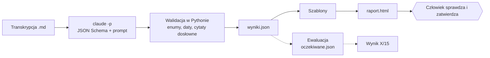

# Rinvo chatfeedbacker

Zamienia transkrypcję rozmowy statusowej z klientem w uporządkowaną listę ustaleń, zadań i zakazów oraz gotowy raport HTML (szkice maili, wpisy do CRM, lista zadań). Człowiek zatwierdza, nic nie jest wysyłane.

## Problem

Po rozmowie z klientem trzeba ręcznie spisać, co kto ma zrobić, do kiedy, co jest wstrzymane i czego na koncie robić nie wolno. Późniejsze wypowiedzi nadpisują wcześniejsze, a podsumowanie na końcu spotkania bywa niepełne. Efekt: pominięte zakazy, złe terminy, brak przypomnień. To narzędzie robi z transkrypcji pierwszy szkic, a człowiek tylko go sprawdza.

## Jak to działa



Każdy element ma krótki `skrot` (jedno konkretne zdanie: co zrobić, z liczbą, datą lub osobą), pełny `opis`, typ, status, właściciela, termin, warunek, przypomnienie i co najmniej jeden cytat. Cytaty są sprawdzane jako dosłowne fragmenty transkrypcji, więc wynik da się zweryfikować.

## Demo krok po kroku

1. `./uruchom.sh --bez-modelu` buduje `raport.html` i liczy ewaluację z zacommitowanego `wyniki.json` (bez `claude`).
2. Otwórz `raport.html` w przeglądarce.
3. Przejrzyj listę elementów. Na wierzchu każdej karty jest tylko status, tytuł, jednozdaniowy skrót, właściciel i termin. Kliknięcie rozwija pełny opis, warunek, przypomnienie i cytaty z rozmowy (dowód).
4. Zobacz zakazy (czego nie robić na koncie) i elementy wstrzymane z warunkiem odblokowania.
5. Zobacz przypomnienia (data, treść, maks. liczba razy) oraz ryzyka/sukcesy dla CRM.
6. Zobacz szkic maila do klienta. Jest krótki: same punkty z terminami w czterech grupach (po naszej stronie, potrzebujemy od Ciebie, czeka na Twój sygnał, prośby o funkcje), bez opisów. Trafiają do niego tylko elementy z `do_klienta: true`, treści wewnętrzne zostają w Rinvo.

## Uruchomienie na innej transkrypcji

Wymagania: `python3` (tylko biblioteka standardowa) i zalogowany `claude` (Claude Code).

```bash
./uruchom.sh moja-transkrypcja.md [--data RRRR-MM-DD] [--oczekiwane oczekiwane.json] [--wyjscie-dir katalog]
```

Data spotkania jest brana z nagłówka transkrypcji, a `--data` ją zastępuje. Ewaluacja idzie tylko z `--oczekiwane` albo dla `samples/transkrypcja-spotkanie.md`; w innym wypadku jest pominięta. Na końcu skrypt wypisuje ścieżkę raportu. Przebieg z modelem trwa ok. 2,5-3,5 min. Testy: `python3 -m unittest`.

## Założenia i ryzyka

- Perspektywa Rinvo: co Rinvo ma zrobić, co ma zrobić klient, czego Rinvo nie wolno.
- Daty liczone z kalendarza podanego modelowi; "do końca tygodnia" to piątek; brak terminu to `null`, nie zgadujemy.
- Statusy: `teraz`, `czeka na klienta`, `wstrzymane`, `backlog`, `zakaz`.
- Nic nie jest wysyłane: maile i wpisy CRM to szkice do ręcznego zatwierdzenia.
- Ewaluacja 15 faktów nie jest miarą kompletności. Sprawdza tylko te fakty, a prompt był poprawiany po jej wynikach tylko ogólnymi regułami.
- Niedeterminizm: dwa przebiegi na tej samej transkrypcji dają różne wyniki (patrz niżej, fakt 15).
- Luka: `claude -p` uruchamiany z katalogu tymczasowego może nadal czytać globalny `~/.claude/CLAUDE.md` użytkownika, co może wpływać na odpowiedzi. Nie sprawdzono pełnej izolacji.
- Transkrypcje mogą zawierać dane osobowe i trafiają do modelu przez `claude`.

## Wyniki ewaluacji

**`samples/transkrypcja-spotkanie.md` (15 faktów): 14/15.** Przebieg z modelem trwa ok. 3:10-3:30.

| Przebieg | Prompt | Wynik | Nie przeszło |
|---|---|---|---|
| wcześniejszy `wyniki.json` | bazowy | 14/15 | 11 (zakaz: nowy mail dla handlowców; model zapisał jako prośbę o funkcję) |
| 1 | + reguła o zakazach i imieniu adresata | 14/15 | 15 (lead na urlopie do oddzwonienia) |
| 2 | jw. | 14/15 | 15 |
| 3 (zacommitowany) | + pole `skrot` | 14/15 | 15 |

Poprawka promptu naprawiła fakt 11, ale w obu przebiegach nie przeszedł fakt 15, który wcześniej przechodził. Nie wiadomo, czy to skutek zmiany promptu, czy niedeterminizmu; limit dwóch poprawek wyczerpany, więc zostawiono tę wersję. Przebieg 3 (po dodaniu pola `skrot`) znów nie zaliczył faktu 15. Trzy przebiegi z rzędu sugerują, że to raczej skutek reguły o osobnych zakazach niż przypadek. Zacommitowany `wyniki.json` pochodzi z przebiegu 3.

**`transkrypcja-test-2.md` (Motorpol Gdańsk, Analiza Rozmów, inny produkt i klient): 8/8 według ręcznego porównania** (powtórzone po dodaniu pola `skrot`, nadal 8/8). Ekstrakcja dostała transkrypcję bez listy faktów (`wyniki-test-2/transkrypcja.md`), 10 elementów, 0 niezweryfikowanych cytatów, ok. 40 s. Porównanie z listą faktów:

1. Błąd rozmów niesprzedażowych (rozmowa Agnieszki, 8.10, sprawdzić dziś): jest (E01).
2. Usunięcie oceny 2 Agnieszki do 16.10: jest (E02).
3. Raport w niedzielę 20:00 zamiast poniedziałku: jest (E03).
4. Eksport do Excela jako backlog: jest (E04).
5. Zakaz oceniania działu flotowego: jest (E05, E06).
6. Kategoria "propozycja finansowania", czeka na Tomasza, jedno przypomnienie 16.10: jest (E07).
7. Korekta faktury, Grunwaldzka 410, Michał, dziś: jest (E08).
8. Agent po godzinach tylko pomysł, bez oferty, czekać na pana Roberta: jest (E09, E10).

Porównanie było ręczne, bez `oczekiwane-test-2.json`, więc jest mniej rygorystyczne niż automatyczna ewaluacja. Wyniki: `wyniki-test-2/`.

## Plan rozwoju

- Podpis maila w `rinvo/raport.py` jest na sztywno ("Marek"); powinien być parametrem.
- Izolacja `claude -p` od globalnych instrukcji użytkownika.
- `oczekiwane-test-2.json` i ewaluacja na wielu transkrypcjach, kilka przebiegów na transkrypcję, by zmierzyć niedeterminizm.
- Wysyłka maili i wpisy do CRM po zatwierdzeniu, edycja szkiców w raporcie.
