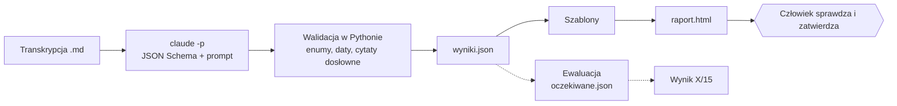

# Rinvo: automatyczna obsługa ustaleń z rozmowy z klientem

System czyta transkrypcję rozmowy statusowej z dealerem i jednym wywołaniem `claude -p` wyciąga z niej wszystkie ustalenia: błędy, zmiany konfiguracji, zadania, prośby o funkcje, zakazy i informacje handlowe. Każdy element ma status, właściciela, konkretną datę, warunek i dosłowny cytat, który Python sprawdza w transkrypcji. Z `wyniki.json` deterministycznie powstaje `raport.html`: zgłoszenia błędów, zmiany konfiguracji, przypomnienia warunkowe, zakazy, backlog, notatka do CRM i krótki szkic maila do klienta. Nic nie jest wysyłane, człowiek przegląda i zatwierdza.



## Zawartość

| Folder | Co jest w środku |
|---|---|
| `01-prototyp-procesu/` | Schemat procesu: `proces.html` (otwórz w przeglądarce, Mermaid z CDN), `proces.md` (ten sam schemat) i `plan.md` (decyzje, kontrakt danych, ryzyka). |
| `02-demo/` | Działający system uruchomiony na transkrypcji: kod (`rinvo/`, `uruchom.sh`, testy), `transkrypcja-spotkanie.md`, `wyniki.json`, `raport.html`, `oczekiwane.json`, skrypt ewaluacji (`rinvo/ewaluacja.py`), `wynik-ewaluacji.txt`, a także `transkrypcja-test-2.md` z wynikami w `wyniki-test-2/`. |
| `03-logi-ai/` | Logi z pracy z AI: sesje Claude Code (z subagentami) i sesja Codexa. Opis w `logi-README.md`. |

## Uruchomienie jedną komendą

Wymagania: `python3` (tylko biblioteka standardowa) i zalogowany `claude` (Claude Code), bez klucza API.

```bash
cd 02-demo
./uruchom.sh moja-transkrypcja.md            # ekstrakcja -> wyniki.json -> raport.html
./uruchom.sh moja-transkrypcja.md --wyjscie-dir wynik-x --oczekiwane fakty.json
./uruchom.sh --bez-modelu                    # demo bez claude: raport + ewaluacja z wyniki.json
```

Data spotkania jest czytana z nagłówka transkrypcji (albo `--data RRRR-MM-DD`). Przebieg trwa ok. 3,5 min na długiej transkrypcji i ok. 40 s na krótkiej.

## Wyniki

- **Transkrypcja Auto Tama, 15 faktów: 15/15** (`02-demo/wynik-ewaluacji.txt`), wszystkie cytaty potwierdzone w transkrypcji.
- **Druga transkrypcja (Motorpol, inny klient i inny produkt), 8 faktów: 8/8.** Porównanie ręczne z listą z końca pliku. Model dostał transkrypcję bez tej listy.

## Znane ograniczenie

Przez większość pracy wynik był **14/15**. Fakt 15 nie przechodził: klientka, która powiedziała „oddzwońcie w przyszłym tygodniu, jestem na urlopie”, to lead do oddzwonienia, a nie odmowa. Model w ogóle nie tworzył dla niej elementu. Ta uwaga Kasi padła przy okazji statystyk i model traktował ją jako komentarz do liczb, a nie jako sprawę do załatwienia.

Na starcie z góry ustaliłem limit dwóch poprawek promptu. Obie naprawiły inne fakty (zakaz nowego maila dla handlowców, adresat informacji), ale nie fakt 15. Fakt 15 nie przeszedł w trzech kolejnych przebiegach. Potem dodałem jeszcze jedną ogólną regułę, bez wiedzy o tym kliencie: gdy klient poprawia klasyfikację konkretnego przypadku, powstaje osobny element. Ten przebieg dał 15/15. Była to trzecia poprawka, ponad pierwotny limit, i jest to wynik jednego przebiegu. Model jest niedeterministyczny, więc kolejny przebieg może znowu dać 14/15. Historia przebiegów jest w głównym `README.md`.

Co zrobiłbym, mając więcej czasu:
- kilka przebiegów na transkrypcję i raportowanie średniej zamiast jednego wyniku,
- dodatkowa transkrypcja testowa z podobnymi przypadkami, przygotowana w ciemno, żeby sprawdzić, że reguła nie jest dopasowana do testu,
- drugi, krótki krok „co przeoczyłeś?”: model dostaje transkrypcję i listę elementów i wskazuje pominięte wypowiedzi z liczbami lub decyzjami.

## Założenia

- Perspektywa Rinvo: co robi Rinvo, czego potrzebujemy od klienta, czego nie wolno.
- Późniejsze wypowiedzi nadpisują wcześniejsze. Podsumowanie z końca rozmowy nie jest źródłem.
- Daty liczy model z kalendarza wygenerowanego w Pythonie. „Do końca tygodnia” to piątek. Brak terminu to `null`, bez zgadywania.
- Przypomnienie warunkowe ma datę dnia granicznego i limit powtórzeń z rozmowy.
- Mail do klienta zawiera tylko elementy z `do_klienta: true`, bez spraw wewnętrznych (np. ryzyko VoiceDesk).
- Ewaluacja sprawdza 15 wybranych faktów, a nie kompletność. Sprawdzenia są deterministyczne i nie zaglądają do cytatów.
- `claude -p` jest uruchamiany w katalogu tymczasowym, bez narzędzi. Pełnej izolacji od globalnych ustawień użytkownika nie zweryfikowano.

## Plan rozwoju

- Kilka przebiegów na transkrypcję i pomiar stabilności. Automatyczne `oczekiwane` dla kolejnych transkrypcji.
- Edycja i zatwierdzanie szkiców w raporcie, potem wysyłka maila i wpisy do CRM dopiero po zatwierdzeniu.
- Przypomnienia jako zadania w kalendarzu, z automatycznym anulowaniem, gdy klient dostarczy materiał.
- Podpis maila i perspektywa (kto jest „nasz”) jako parametry.
- Integracja z CRM dealera, bo to główny argument konkurencji (VoiceDesk).
